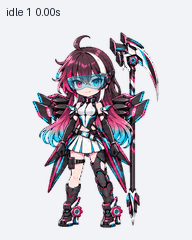
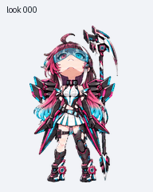
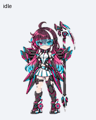

# EZ娘 · Windows 桌面伙伴

EZ 赛车主题 Windows 桌面伙伴，包含九种动作与十六向注视。保留渐变长发、异色瞳、青色目镜、碳纤维翼片和直柄镰刀。






## 下载与分享

可通过以下链接直接下载，无需登录 GitHub：

**[下载最新版 Windows 安装包](https://github.com/z10-01z/ez-pet/releases/latest)**

下载 `EZ-Pet-v1.1.1-Windows.zip`，完整解压后按下方方式安装。不要把整个 ZIP 直接拖进伙伴列表。

v1.1.1 修复鼠标悬停触发跳跃时的突变：首尾改为接近待机的直立姿势，使用小幅轻跳，统一预留顶部空间，保留清晰线条及九种动作与十六向注视。客户端格式固定为每帧 **192×208**；本次改善原生尺寸可读性，图集仍为 **1536×2288**，并非扩大客户端支持分辨率。

## 桌面安装链接

支持伙伴安装链接的桌面客户端，可把下面整行复制到浏览器地址栏，打开安装预览后再确认安装。此方式需要客户端启用对应功能；如果没有反应，使用安装包。

```text
codex://pets/install?name=EZ%E5%A8%98&imageUrl=https%3A%2F%2Fraw.githubusercontent.com%2Fz10-01z%2Fez-pet%2Fv1.1.1%2Fez-girl%2Fspritesheet.png&description=EZ%20%E8%B5%9B%E8%BD%A6%E4%B8%BB%E9%A2%98%E6%9C%BA%E8%83%BD%E4%BC%99%E4%BC%B4%EF%BC%9A%E6%B8%90%E5%8F%98%E9%95%BF%E5%8F%91%E3%80%81%E5%BC%82%E8%89%B2%E7%9E%B3%E3%80%81%E9%9D%92%E8%89%B2%E7%9B%AE%E9%95%9C%E3%80%81%E7%A2%B3%E7%BA%A4%E7%BB%B4%E7%BF%BC%E7%89%87%E4%B8%8E%E7%9B%B4%E6%9F%84%E9%95%B0%E5%88%80%E3%80%82&spriteVersionNumber=2
```

链接格式来自 [官方桌面命令说明](https://learn.chatgpt.com/docs/reference/commands#pets)。图片固定指向 v1.1.1，避免后续版本改变下载内容。选择安装包或桌面链接其中一种即可；已安装的用户建议使用脚本原位更新。

## 手动安装

1. 按 `Win + R`，输入 `%USERPROFILE%\.codex\pets`，按回车。目录不存在时先创建它。
2. 把解压包中的整个 `ez-girl` 文件夹复制到这里。最终应有：

   ```text
   .codex/
     pets/
       ez-girl/
         pet.json
         spritesheet.png
   ```

3. 打开桌面应用的「设置 → 迷你界面和智能伙伴」（部分版本称「Pets」），点击「我的智能伙伴」右侧的 **↻ 刷新**，选择 **EZ娘**。

如果设置过 `CODEX_HOME` 环境变量，请安装到该目录下的 `pets\ez-girl`。需要更新时，优先使用下方脚本，它会自动保留旧文件。

## 脚本安装或更新

在解压后的文件夹打开 PowerShell，执行：

```powershell
powershell.exe -NoProfile -File .\install.ps1
```

如果系统的脚本策略阻止执行，可以使用上方手动安装方法。

脚本支持 Windows PowerShell 5.1，无需管理员权限，也无需安装 Python、Node.js 或其他依赖。它会：

- 优先使用 `$env:CODEX_HOME\pets`；没有设置时使用 `%USERPROFILE%\.codex\pets`。
- 始终安装到同一个 `ez-girl` 文件夹，重复安装会原位更新。
- 更新前，将整个旧 `ez-girl` 备份到同级 `pet-backups\ez-girl\时间戳` 下，备份不会出现在伙伴列表中。
- 检查精灵图 SHA-256，完成后提示刷新列表。

自定义安装根目录：

```powershell
powershell.exe -NoProfile -File .\install.ps1 -Destination 'D:\MyCodex\pets'
```

`-Destination` 指向 **pets 根目录**，脚本会自行追加 `ez-girl`。

## 更新与恢复

更新时下载并解压新版，再执行 `install.ps1`。保留文件夹名 `ez-girl`，避免出现同名伙伴的多个条目。

如需恢复旧版，把备份中的 `ez-girl` 内容复制回安装目录，再刷新列表。手动更新前，也可以自行将旧文件夹备份到 `pets` 目录之外。

## 文件校验

发布页同时提供 `SHA256SUMS.txt`，其中记录 ZIP 的 SHA-256。下载后可检查：

```powershell
Get-FileHash -LiteralPath .\EZ-Pet-v1.1.1-Windows.zip -Algorithm SHA256
```

最终精灵图：透明 PNG，1536 × 2288，v2，73 个有效帧；SHA-256：

```text
28f4f528d4bd1260ec4815721fd5c126ab1ced1868bf5c2d08d7029c11411c5c
```

## 动画流畅度

当前客户端使用固定帧数与播放时间：跳跃为 5 帧，通常每帧 140 毫秒、末帧 280 毫秒；待机的停帧时间更长，鼠标跟随为 16 个离散方向。伙伴 JSON 没有自定义 FPS 参数，不能通过加入 fps 字段或扩大图集来变成 30/60 FPS。v1.1.1 通过减小动作幅度、匹配首尾站姿改善突变，没有修改客户端或声称提高播放帧率。

悬停预览按实际客户端时间导出；九种动作总览用于查看动作内容，不代表待机在客户端中的实际速度。

## 客户端与常见问题

- 需要 Windows 桌面版 ChatGPT/Codex，并支持自定义 v2 伙伴。已用 26.1103.4239.0 的伙伴读取与播放逻辑核对格式及停帧时间。
- 安装后找不到：确认文件夹层级正确、`pet.json` 与 PNG 在一起，再点击刷新。
- 出现多个 EZ娘：检查是否复制成了 `ez-girl-2`、`ez-girl (1)` 等多个直接子文件夹。保留固定目录，备份放到 `pets` 之外。
- 动画不播放：检查操作系统是否开启了减少动画/减少动态效果。
- 此安装包安装本机伙伴文件，不操作云端 Pets 接口，不会替换当前选中的伙伴。

## 分享

本仓库公开，无需登录 GitHub 即可访问。分享 [最新发布页](https://github.com/z10-01z/ez-pet/releases/latest) 即可；安装包内有中文说明与动画预览。

## 内容说明

本包基于 EZ娘最终设定制作，角色图像与动画使用 AI 图像生成工具完成，经动作、方向和图集检查后整理分发。用于角色展示与桌面陪伴。仓库仅包含分发所需的伙伴文件、安装脚本、预览与安装测试，不包含本机配置、账号记录或客户端提取代码。
